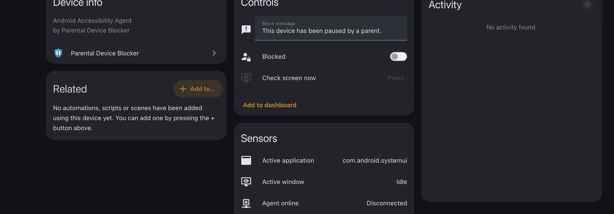

<p align="center">
  
</p>

<h1 align="center">Parental Device Blocker</h1>

<p align="center">
  Home Assistant parental controls for Windows PCs and Android phones — block enforcement, activity telemetry, optional screen assessment, and a child-scoped points portal.
</p>

> [!WARNING]
> Experimental parental-control aid, not a tamper-proof security boundary. Supervise setup, keep a separate parent administrator account, and test emergency recovery before relying on enforcement.

## Features

Each configured device exposes Home Assistant entities for:

- requested and effective blocked state;
- an editable block message;
- agent connectivity and foreground application/window telemetry;
- optional passive Android location (cached fix only);
- optional read-only VNC screen assessment and bounded text-only reports;
- optional one-hour parent PIN override at the locked device;
- Windows points/chores portal when Family Chore Manager is installed.

Windows uses a `LocalSystem` service plus a session companion. Android uses Accessibility enforcement with deliberate fail-open behaviour during outages.

## Screenshots



**Device page in Home Assistant** — Android Accessibility Agent controls, sensors, and activity.

Additional captures (config flow, options, dashboard) will be added under `docs/screenshots/` as they are ready.

## Install (HACS)

1. **HACS → Integrations → Custom repositories** — add `https://github.com/jr551/hacs-parental-deviceblocker` as an **Integration**.
2. Install **Parental Device Blocker** and restart Home Assistant.
3. **Settings → Devices & services → Add integration** → **Parental Device Blocker**.
4. Add one entry per PC or phone. Copy each generated **Device API key** only into that device's agent.

The internal domain remains `rowe_pc_blocker` for compatibility. Optional YAML import: `deploy/home-assistant/rowe_pc_blocker.yaml.example`.

### Parent PIN override

Open the device entry **Configure** options and set a parent PIN (at least four characters). Leave the field blank to keep the saved PIN. **Disable parent PIN override** clears it until a new PIN is set.

### Screen assessment (optional)

Enable in options with VNC host/password and an HTTPS OpenAI-compatible provider. Screenshots are not retained; only a short text assessment is stored.

## Windows agent

Build with .NET 8 or `./scripts/build-release.sh 0.10.0`. Install with `deploy/windows/Install-RowePcBlocker.ps1` (monitor-only first, then `Enable-UserInterface.ps1` and `Enable-Enforcement.ps1`). Emergency recovery: `Emergency-Unblock.ps1`.

Wire protocol (unchanged): [`docs/PROTOCOL.md`](docs/PROTOCOL.md).

## Android agent

Sideload APK from `./scripts/build-android-docker.sh`. Server-mediated S3 media backup was **removed in 0.10.0**; legacy `/backup/*` API paths still return `enabled: false` so older app builds fail gracefully. See [android deploy checklist](docs/android-deploy-checklist.md).

## Compatibility identifiers (legacy names)

Shipped agents depend on these **technical** identifiers. User-facing branding is *Parental Device Blocker*; do not rename these in releases without a coordinated client migration.

| Token | Value |
| --- | --- |
| HA domain / folder | `rowe_pc_blocker` |
| API prefix | `/api/rowe_pc_blocker/` |
| Preferred auth header | `X-Device-Blocker-Key` |
| Legacy auth header | `X-Rowe-Key` |
| Windows service / binaries | `RowePcBlocker`, `RowePcActivity` |
| Android application ID | `lol.rowe.blocker` |

## Development

```bash
python3 -m unittest discover -s tests -p 'test_*.py' -v
python3 -m compileall -q custom_components/rowe_pc_blocker
```

## Changelog

See [CHANGELOG.md](CHANGELOG.md).

Licensed under the [MIT License](LICENSE).
